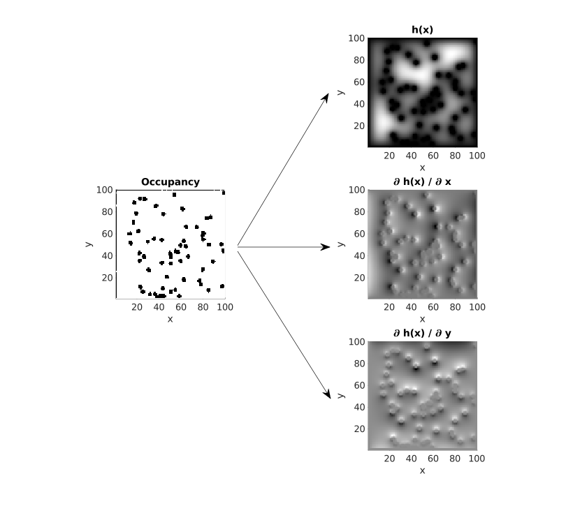
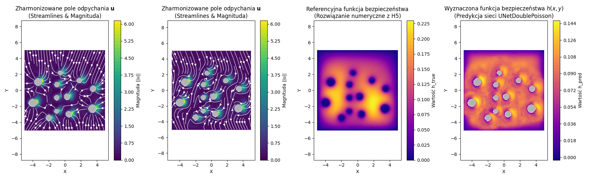
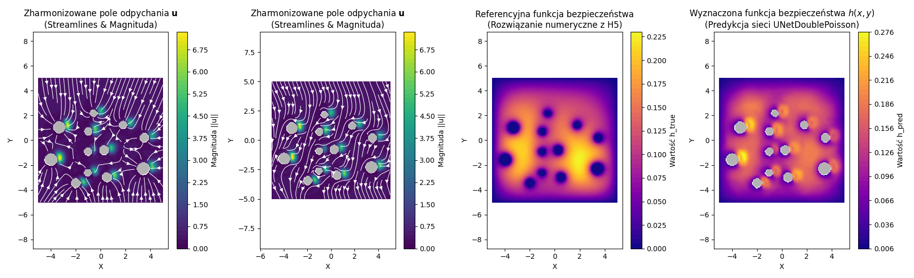
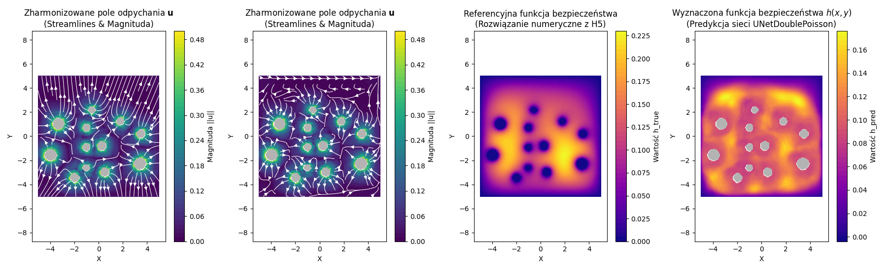
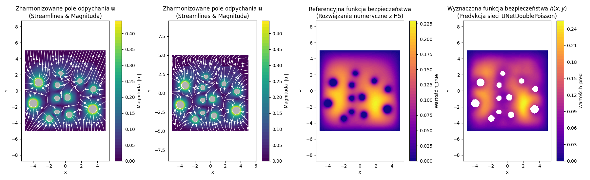

# Poisson Safety Boundary Determiner

Tools for generating Poisson safety-function datasets and training or running
neural-network models on occupancy grids.



## Features

- Generate obstacle maps and reference fields with a Python finite-difference
  solver.
- Train a `UNetDoublePoisson` model.
- Run inference on HDF5 occupancy-grid datasets.
- Explore the separate C++ solver described in [`cpp/README.md`](cpp/README.md).

## Setup

Install the Python dependencies:

```bash
pip install -r requirements.txt
```

The pinned dependencies include CUDA-related packages. If installation fails
on your platform, install a PyTorch build appropriate for your system and
adjust the dependency list as needed.

## Generate training data

The Python generator creates obstacle maps and reference fields on a square
grid. For example, generate 500 maps at 512 × 512 resolution using four threads:

```bash
python generate_data.py data/training_data_512x512_500.h5 500 512 --num-threads 4
```

The HDF5 file contains the groups `grid`, `u_x`, `u_y`, `h`, `dhdx`, and `dhdy`.
Each sample is stored under a zero-padded numeric key. The generated fields
cover the domain `[-5, 5] × [-5, 5]`.

## Train a model

```bash
python train_pinn.py \
  --data_file data/training_data_512x512_500.h5 \
  --epochs_number 5 \
  --weights_path weights/model.pth
```

Training uses CUDA when available and otherwise runs on CPU. It saves the model
weights and normalization statistics alongside the configured weights path.

## Run inference

Use a trained checkpoint and its matching normalization statistics:

```bash
python run_inference.py \
  --data-path data/training_data_512x512_500.h5 \
  --weights-path weights/model_best.pth \
  --norm-stats-path weights/model_norm_stats.pt \
  --sample-index 0
```

Omit `--sample-index` to process all samples. Add `--cpu` to force CPU
inference or `--show` to display the plots. Prediction plots are saved in
`fig/`.

## Analyze trajectory distance to obstacles

The trajectory analysis script reads straight-line segments between CSV nodes,
resamples each path by arc length, and estimates distance to neutral-gray
obstacle regions in the supplied plot image:

```bash
python analyze_trajectory_obstacle_distance.py paths.csv \
  --image corridor_zigzag_3.png \
  --output-dir trajectory_analysis
```

The script selects calibration by the CSV scenario when a preset is available
(`corridor_zigzag_3` and `carla_08`); otherwise it uses the
`corridor_zigzag_3` defaults. Override calibration with `--plot-bounds`
(`LEFT RIGHT TOP BOTTOM` in pixels) and `--world-bounds`
(`X_MIN X_MAX Y_MIN Y_MAX`) for other maps. For example, the Carla 08 capture
can be analyzed with:

```bash
python analyze_trajectory_obstacle_distance.py \
  /path/to/run_carla_step_005/paths.csv \
  --image /path/to/run_carla_step_005/preview_carla_08.png \
  --output-dir output/carla
```

It writes one profile per trajectory, mean and sample standard deviation at
each normalized path position, per-path distance statistics, and a plot with
English labels. Distances are estimates from the rasterized image, rather
than exact distances to vector obstacle boundaries.

## Repository layout

- `generate_data.py` — Python dataset generator.
- `analyze_trajectory_obstacle_distance.py` — trajectory-to-obstacle distance analysis.
- `train_pinn.py` — model training.
- `run_inference.py` — inference and prediction plots.
- `data/` — HDF5 datasets.
- `models/` — model definitions.
- `weights/`, `results/release_weights/` — model weights and normalization data.
- `cpp/` — C++ solver and its instructions.
- `fig/` — example figures.

## Example results





